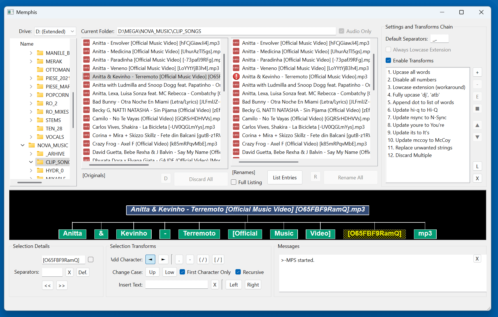

# README #

Visually rename your mp3 files. 

**WARNING:** *Use at your own risk*. 

I haven't taken the time to test all memory allocation issues, and there are quite some. That's because I'm using raw pointers. There, I've said it. Yes, I know there are smart pointers and ~~I am planning on refactoring the app and use them~~. 

But until then, use at your own risk.

### Dependencies ###

* Qt 6.12.0 with the MinGW 13.1.0 64-bit kit
* Boost 1.92.0 built for MinGW 13.1.0
* The separate `MEMPHIS_LIB` project, built with the same MinGW toolchain

### Build Instructions ###

[Download Qt (for Windows)](https://www.qt.io/download-qt-installer-oss)
[Download boost](https://www.boost.org/releases/latest/)

Open `MemphisNow.pro` in Qt Creator and select the Qt 6.12.0 MinGW 13.1.0
64-bit kit. The project expects the sibling directories laid out as follows:

* `../MEMPHIS_LIB`, with its MinGW build output in `../MEMPHIS_LIB/build`
* `../_LIBS/boost_1_92_0/mingw-install`

The qmake project uses the Memphis headers and `libmemphis.dll.a` import
library, and includes Boost 1.92.0 headers. After each successful build, it
copies the Memphis DLL, Boost.Filesystem DLL, and MinGW runtime DLLs beside the
executable so the Memphis DLL dependencies can be found when the application
starts. Qt's runtime DLLs are still supplied by the selected Qt kit when
running from Qt Creator.

### License ###

This project is licensed under the GNU General Public License v3.0 - see the [LICENSE](./LICENSE.txt) file for details.
